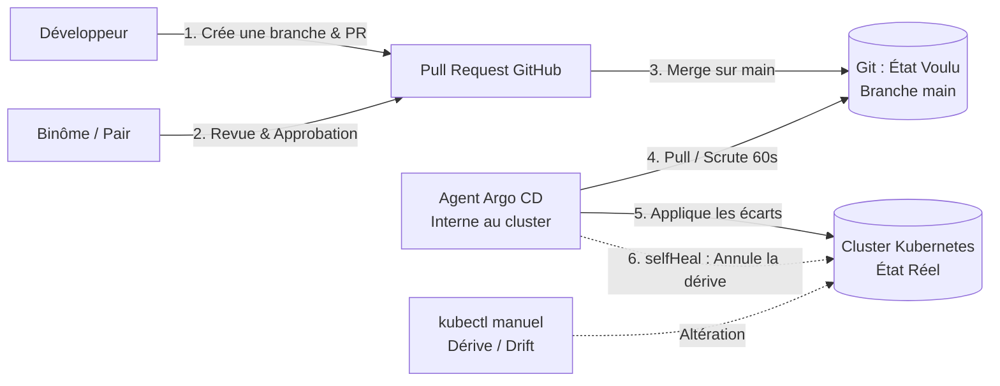
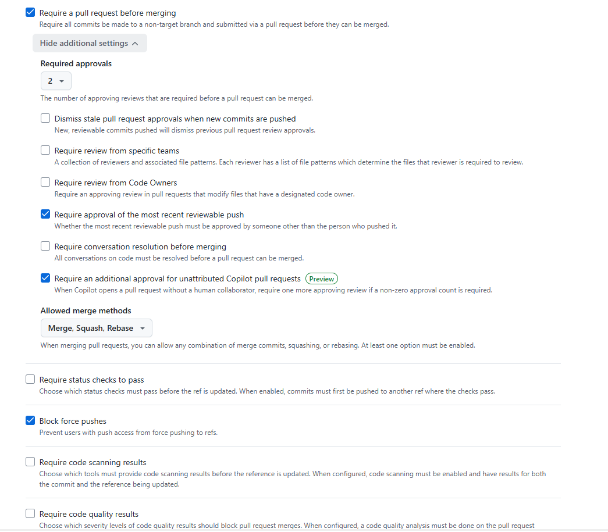
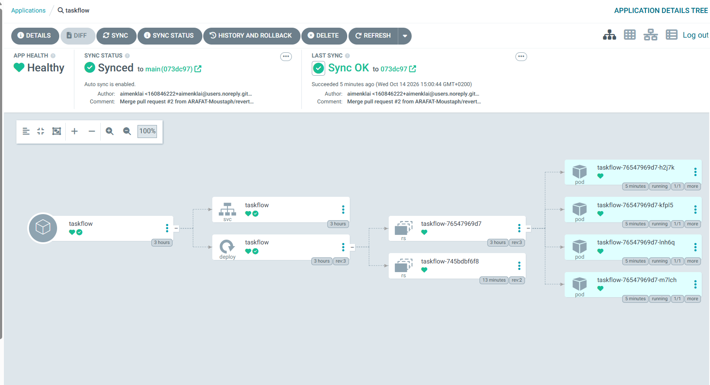
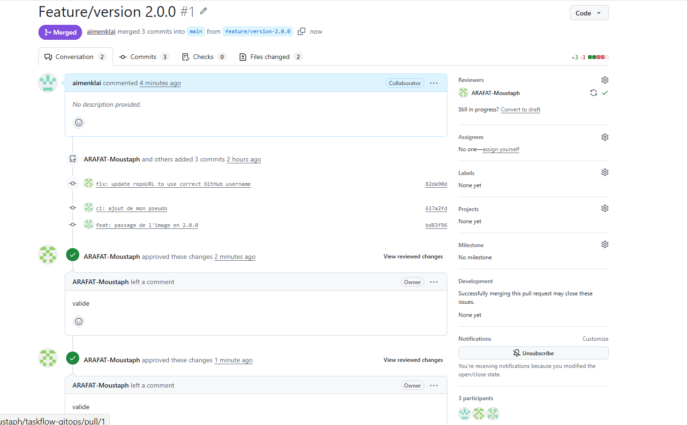
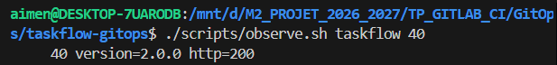
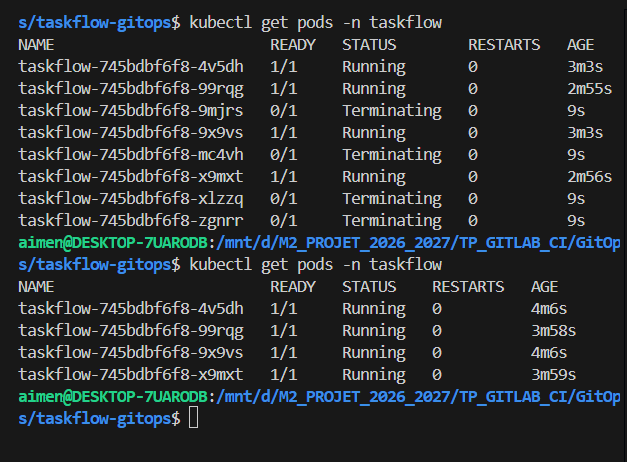
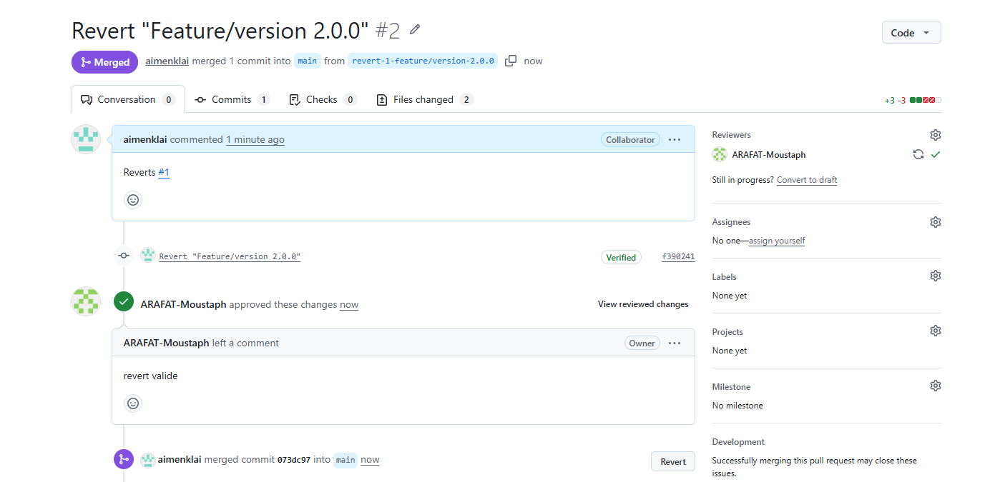

# Mastère DevOps M2 — Sup de Vinci
## Module E54 : CI/CD Avancé & Déploiement Continu
### Bloc 5, RNCP 40165 · Activité 12b : GitOps et Stratégies de Release

---

## 👥 Composition de l'Équipe
- **Aimen KLAI** ([@aimenklai](https://github.com/aimenklai))
- **Moustapha ARAFAT** ([@ARAFAT-Moustaph](https://github.com/ARAFAT-Moustaph))
- *(3ème membre du groupe)*

**Dépôt GitOps officiel de l'équipe :** [https://github.com/ARAFAT-Moustaph/taskflow-gitops](https://github.com/ARAFAT-Moustaph/taskflow-gitops)

---

## 🏗️ 1. Principes d'Architecture & Boucle GitOps

Le principe fondamental mis en œuvre dans ce lab est que **Git est l'unique source de vérité (*Single Source of Truth*) pour la production**. 

Aucune modification n'est poussée directement sur le cluster via un accès administrateur distant. L'état voulu est déclaré dans Git, et un agent interne au cluster (**Argo CD**) réconcilie l'état réel en continu :



---

## 🧠 2. Réponses aux Questions Théoriques de la Slide 9

### Question 1 : Déploiement Push ou Pull ?
> **Réponse détaillée :**  
> Notre architecture repose sur un modèle **Pull (GitOps)** :
> - **Modèle Push classique :** Le pipeline CI (ex: GitLab CI, GitHub Actions) détient des identifiants à privilèges élevés (`kubeconfig`, token admin) et pousse les manifests sur le cluster via `kubectl apply`. Cela présente deux défauts majeurs : une exposition critique des secrets d'infrastructure à l'extérieur du cluster et une incapacité à détecter les modifications manuelles directes faites sur le cluster.
> - **Modèle Pull (GitOps avec Argo CD) :** Aucun accès réseau entrant n'est ouvert vers le cluster. L'agent **Argo CD** réside à l'intérieur du cluster et scrute (*pull*) le dépôt Git à intervalle régulier (configuré à 60s). Il compare en permanence l'état désiré (Git) avec l'état réel (Kubernetes). Ce modèle garantit une sécurité renforcée (principe du moindre privilège) et une détection automatique de la dérive.

---

### Question 2 : Qui a corrigé quoi lors de la dérive (*Drift*) ?
> **Réponse détaillée :**  
> Lors du test de dérive où nous avons altéré manuellement l'état du cluster via la commande :  
> `kubectl scale deployment taskflow -n taskflow --replicas=8`  
> C'est **Argo CD** qui a détecté et corrigé l'anomalie grâce à la politique déclarative :
> ```yaml
> syncPolicy:
>   automated:
>     selfHeal: true
>     prune: true
> ```
> Argo CD a constaté un écart (*OutOfSync*) entre les 8 pods en cours d'exécution et les `replicas: 4` définis dans Git. En **9 secondes**, il a marqué les 4 pods excédentaires en `Terminating` et les a supprimés, ramenant le cluster à la configuration exacte validée sur Git.

---

### Question 3 : Pourquoi faire un `git revert` plutôt qu'une commande manuelle sur le cluster ?
> **Réponse détaillée :**  
> En GitOps, **toute commande directe comme `kubectl rollout undo` ou `kubectl set image` est vouée à l'échec** car Argo CD la considérerait comme une dérive non autorisée et la rejetterait au cycle suivant.  
> L'utilisation de `git revert` présente des avantages majeurs :
> 1. **Respect de la source de vérité :** Le cluster reste parfaitement aligné avec la branche `main` sans divergence.
> 2. **Auditabilité et traçabilité (MSPR 4.1) :** Le rollback génère un commit explicite, passe par une Pull Request, et nécessite l'approbation d'un collègue (principe des 4 yeux garanti par le Ruleset).
> 3. **Réversibilité totale :** L'historique Git n'est pas réécrit ; le retour arrière est lui-même annulable si nécessaire.

---

## 📊 3. Journal des Déploiements (Chronométrie & Observations)

| Heure | Version cible | Action / Événement | Acteur / Mécanisme | Délai mesuré | Résultat technique observé |
|---|---|---|---|---|---|
| **12:12** | `1.0.0` | Déploiement initial | `kubectl apply -f argocd/application.yaml` | Immédiat | Application créée dans Argo CD. 4 pods déployés. `./scripts/observe.sh` valide **40/40 requêtes en 1.0.0 (HTTP 200)**. |
| **14:52** | `2.0.0` | Montée de version majeure | PR #1 mergée sur `main` (Branche `feature/version-2.0.0`) | **~40 secondes** | Rolling Update automatique déclenché par Argo CD. `./scripts/observe.sh` confirme la bascule : **40/40 requêtes en 2.0.0 (HTTP 200)**. |
| **14:56** | `2.0.0` | Test de dérive (*Drift*) | `kubectl scale --replicas=8` tapé à la main | **9 secondes** | Dérive détectée par Argo CD : passage immédiat des 4 pods non autorisés en `Terminating`. Rétablissement strict des 4 pods de Git. |
| **15:00** | `1.0.0` | Rollback d'urgence | PR #2 (`git revert`) validée et mergée | **~35 secondes** | Rétrogradation automatique par Argo CD vers la version 1.0.0. `./scripts/observe.sh` confirme **40/40 requêtes en 1.0.0 (HTTP 200)**. |

---

## 📸 4. Galerie des Preuves Visuelles

Les captures d'écran suivantes ont été enregistrées dans le dossier [`screenshots/`](screenshots/) :

### Preuve 1 : Protection de la branche principale (`main`) via Ruleset GitHub
Configuration imposant :
- Une Pull Request obligatoire avant tout merge.
- L'approbation minimale d'un collègue (relecture par les pairs).
- Le blocage des `git push --force`.


---

### Preuve 2 : Topologie complète et état nominal dans l'interface Argo CD
Visualisation de l'application `taskflow` sous Argo CD montrant les statuts **Synced** et **Healthy**, la liaison avec le dépôt Git et l'arbre des 4 pods opérationnels.


---

### Preuve 3 : Pull Request #1 de montée en v2.0.0 (Revue & Approbation)
Démonstration du principe des 4 yeux : Pull Request créée par Aimen KLAI, revue et formellement approuvée par Moustapha ARAFAT (`APPROVED`) avant déblocage du merge.


---

### Preuve 4 : Déploiement effectif de la version 2.0.0
Exécution du script `./scripts/observe.sh taskflow 40` démontrant que 100% du trafic entrant reçoit une réponse HTTP 200 de la version `2.0.0`.


---

### Preuve 5 : Détection de dérive et auto-guérison (*Self-Healing*)
Capture du terminal montrant la tentative d'altération manuelle (`scale 8`) et la réaction instantanée d'Argo CD qui passe les pods hors-Git en statut `Terminating` (à 9 secondes de vie) pour revenir à 4 réplicas.


---

### Preuve 6 : Rollback propre par Git Revert (Pull Request #2)
Pull Request de revert générée automatiquement depuis l'interface GitHub, validée et fusionnée, ramenant le cluster à la version `1.0.0` de façon totalement tracée.


---

## 🛠️ 5. Guide de Reproduction & Commandes Utilisées

### 1. Installation de l'infrastructure locale
```bash
# Dans WSL2 Ubuntu :
git clone https://github.com/ARAFAT-Moustaph/taskflow-gitops.git
cd taskflow-gitops
./scripts/install.sh
```

### 2. Déploiement de l'Application Argo CD
```bash
kubectl apply -f argocd/application.yaml
kubectl get applications -n argocd
```

### 3. Test de connectivité et répartition de charge
```bash
./scripts/observe.sh taskflow 40
```

### 4. Accès au Dashboard Argo CD
```bash
./scripts/argocd-ui.sh
# Ouvrir https://localhost:8080 (identifiant: admin)
```

### 5. Test de la dérive (Drift)
```bash
kubectl scale deployment taskflow -n taskflow --replicas=8
kubectl get pods -n taskflow
# Constater le passage automatique en Terminating des pods surnuméraires
```
