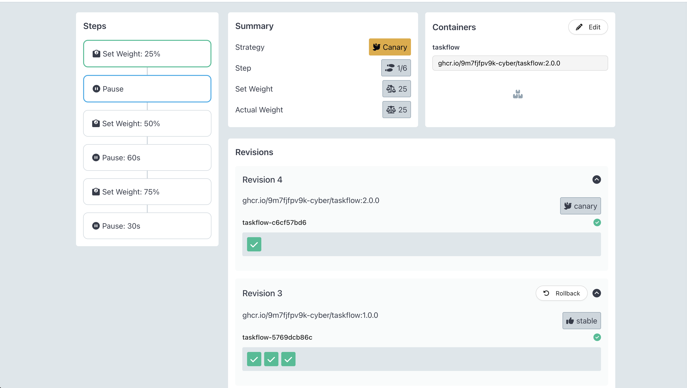
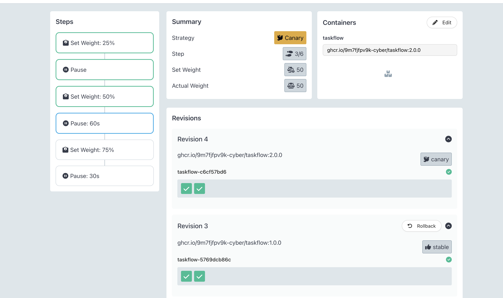
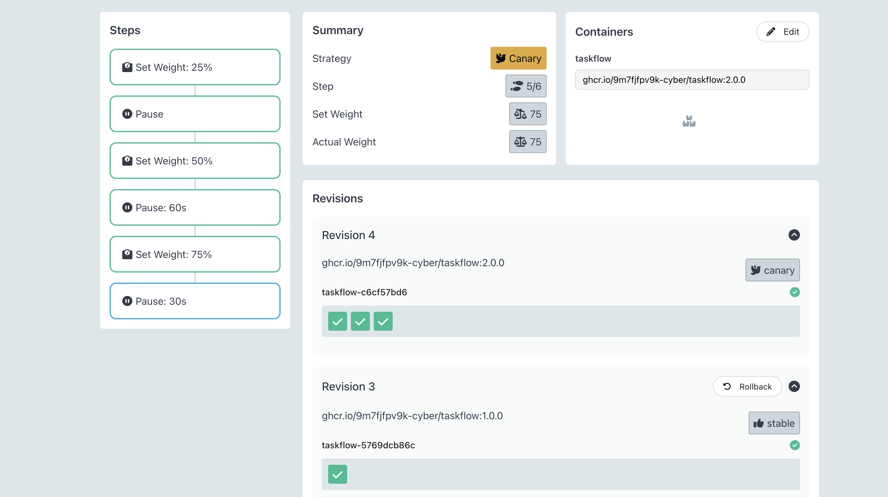
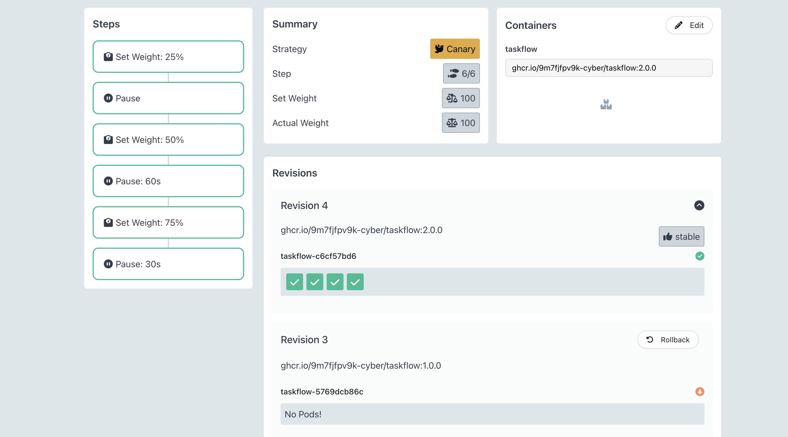
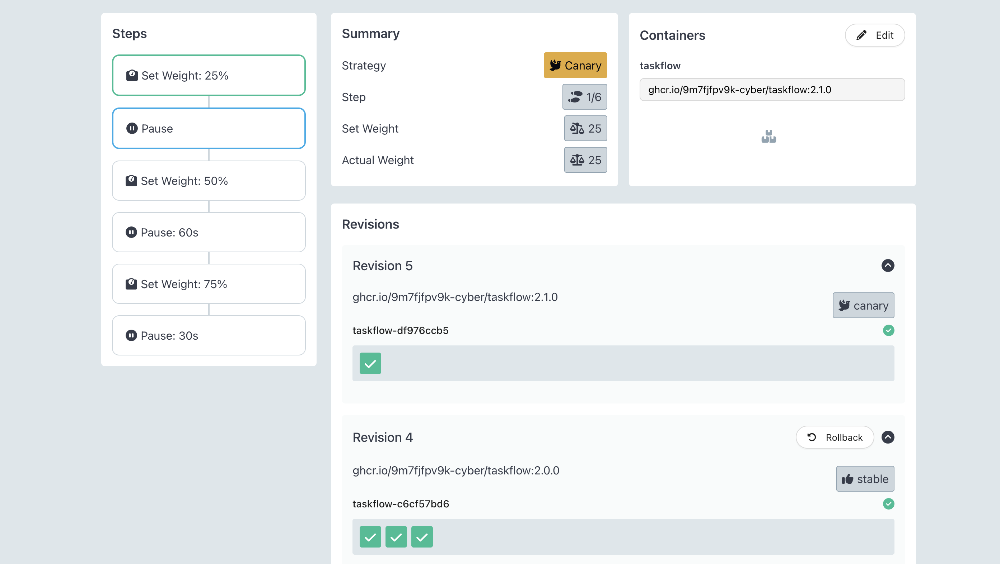
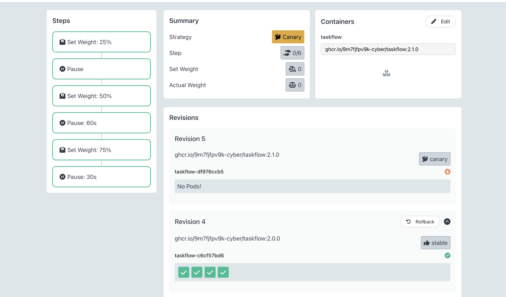
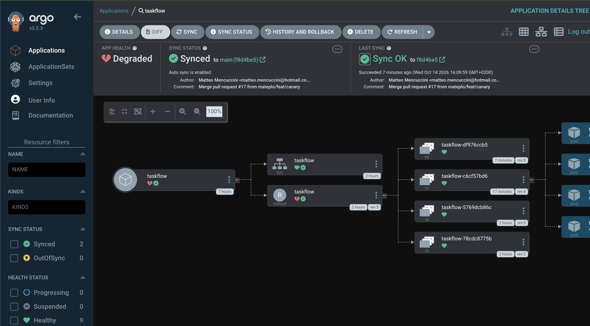
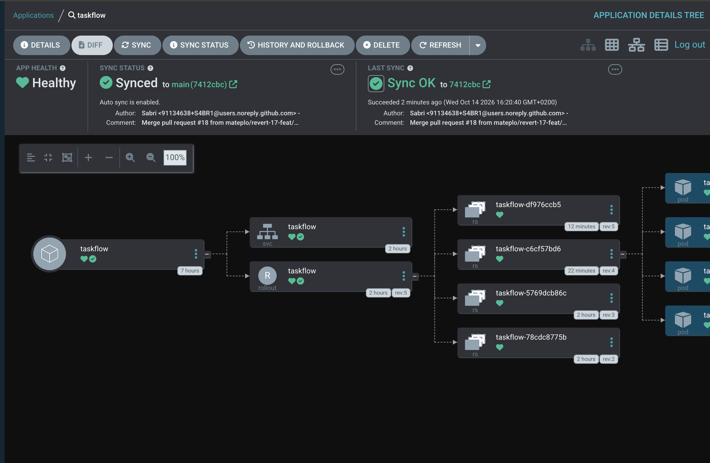

# taskflow-gitops — dépôt GitOps du cours CI/CD M2

Ce dépôt décrit **l'état voulu** de l'application TaskFlow dans Kubernetes.
Argo CD le surveille et aligne le cluster dessus : pour changer la production,
on ne tape pas de commande, on fait une **Pull Request**.

## Installation (à faire chez vous, avant le cours)

Prérequis : Docker Desktop démarré, 8 Go de RAM, 10 Go de disque libre.
Sous Windows : WSL2 (Ubuntu) + intégration WSL de Docker Desktop, et toutes les commandes dans WSL.

```bash
git clone https://github.com/9m7fjfpv9k-cyber/taskflow-gitops.git
cd taskflow-gitops
./scripts/install.sh
```

Le script crée un cluster local `kind`, installe Argo CD et Argo Rollouts,
puis télécharge les images des labs. Comptez 5 à 15 minutes.
Il peut être relancé sans risque.

## Structure

| Chemin | Rôle |
| --- | --- |
| `apps/taskflow/` | Les manifests surveillés par Argo CD |
| `argocd/application.yaml` | Déclare l'application dans Argo CD |
| `exemples/bluegreen/` | Manifests pour le déploiement Blue-Green |
| `exemples/canary/` | Manifests pour le déploiement Canary |
| `exemples/robustesse/` | Canary avec test de charge k6 automatique, modèle de postmortem |
| `exemples/ci/` | Pipelines de la mini-PSSI (GitHub Actions et GitLab CI) |
| `policies/` | Mini-PSSI et règles Rego vérifiées par conftest |
| `scripts/install.sh` | Installation de l'environnement |
| `scripts/argocd-ui.sh` | Ouvre l'interface d'Argo CD |
| `scripts/observe.sh` | Montre quelle version répond, et avec quel code HTTP |
| `scripts/charge.sh` | Lance à la main le test de charge k6 contre un service |

## Images disponibles

`ghcr.io/9m7fjfpv9k-cyber/taskflow` en versions `1.0.0`, `1.1.0`, `2.0.0`, `2.1.0` et `2.2.0`.

## Équipe

<!-- Noms du binôme -->
- Matteo MENCUCCINI
- Sabri ABID

## Livrable

### Argo CD : déploiements par Pull Request et `git revert`


Tous les déploiements viennent d'un pull, car c'est Argo CD qui va regarder la source de vérité (le repo GitHub) et ordonner le déploiement/la modification des ressources sur le cluster Kubernetes.

Le `git revert` sert à annuler les changements d'un commit existant, et donc à revenir en arrière. Cela permet à Argo CD d'annuler des changements faits (venant du repo ayant été modifié), car le nouveau commit de revert ramène le code à l'état d'avant (du point de vue du code, on est revenu en arrière ; du point de vue de l'historique, on a un commit en plus). Argo CD suit simplement la tête de la branche et aligne le cluster dessus.

### Argo Rollouts : Blue-Green

Comme on peut le voir, après avoir lancé la PR remplaçant le Deployment par un Rollout Blue-Green, et avoir lancé la deuxième PR pour changer la version de l'application, nous avons maintenant 4 pods dans l'ancienne version et 4 dans la nouvelle (chacune étant exposée via un service, comme précisé dans le YAML du Rollout : `taskflow` pour la version active, `taskflow-preview` pour la nouvelle).


Nous pouvons maintenant faire le promote du Rollout : le service actif `taskflow` bascule des pods blue (1.0.0) vers les pods green (1.1.0), qui deviennent la version de référence après le promote.

État avant promote :

```console
$ ./scripts/observe.sh
     40 version=1.0.0 http=200

$ kubectl get pods -n taskflow
NAME                        READY   STATUS    RESTARTS   AGE
taskflow-5769dcb86c-8nxzg   1/1     Running   0          46m
taskflow-5769dcb86c-dfzvd   1/1     Running   0          46m
taskflow-5769dcb86c-sj4nq   1/1     Running   0          46m
taskflow-5769dcb86c-wt95t   1/1     Running   0          46m
taskflow-78cdc8775b-97kbw   1/1     Running   0          11m
taskflow-78cdc8775b-dkbj6   1/1     Running   0          11m
taskflow-78cdc8775b-qbprt   1/1     Running   0          11m
taskflow-78cdc8775b-z6tv7   1/1     Running   0          11m
```

Résultat sur le service preview :

```console
$ ./scripts/observe.sh taskflow-preview
     40 version=1.1.0 http=200
```

Comme nous pouvons le voir, le rollout est instantané, car la nouvelle version a entièrement été poussée sur le cluster avant que l'ancienne version ne soit supprimée (principe du Blue-Green). La bascule se résume à un changement de selector sur le service, et les anciens pods sont supprimés 30 s plus tard (`scaleDownDelaySeconds: 30`).


État après promote :

```console
$ ./scripts/observe.sh
     40 version=1.1.0 http=200
```

### Argo Rollouts : Canary

Pour le Canary, on peut voir qu'après la synchronisation par Argo CD, on bloque à 25 % de pods en nouvelle version (soit 1 pod sur 4 dans notre cas), car l'étape `pause: {}` n'a pas de durée et attend un promote manuel.



Avec le script, on peut voir que la charge bascule bien en fonction de la proportion de pods en 1.0.0 et en 2.0.0 (la répartition est approximative, car les requêtes sont distribuées aléatoirement entre les pods) :

```console
$ ./scripts/observe.sh
     33 version=1.0.0 http=200
      7 version=2.0.0 http=200
```

En lançant la suite (Promote), nous allons d'abord passer à 50 % avec une pause de 60 secondes, puis à 75 % avec une pause de 30 secondes, et enfin à 100 % en nouvelle version. Tout cela peut être interrompu avec Abort pour revenir en 1.0.0, ou même PromoteFull pour tout passer en 2.0.0 d'un coup. Dans notre cas, nous allons laisser le cheminement se faire et prendre des captures des différents états.

#### 50 %



```console
$ ./scripts/observe.sh
     18 version=1.0.0 http=200
     22 version=2.0.0 http=200
```

#### 75 %



```console
$ ./scripts/observe.sh
      6 version=1.0.0 http=200
     34 version=2.0.0 http=200
```

#### 100 %



```console
$ ./scripts/observe.sh
     40 version=2.0.0 http=200
```

### Argo Rollouts : Abort d'un Canary

On va maintenant faire un Abort sur un Rollout Canary, avec le passage de la 2.0.0 à la 2.1.0.

Nous pouvons voir que le Rollout marche correctement (le pod en 2.1.0 est prêt, et le Rollout est en pause à 25 %) :



Regardons la charge de plus près :

```console
$ ./scripts/observe.sh
     29 version=2.0.0 http=200
      7 version=2.1.0 http=200
      4 version=aucune http=500
```

Une erreur est présente sur la nouvelle version : environ 1 requête sur 3 envoyée à la 2.1.0 renvoie une erreur 500 (4 sur 11). Nous allons donc faire un Abort du Rollout :



Argo CD affiche donc l'application en Degraded : le cluster tourne en 2.0.0, alors que le repo GitHub demande toujours la 2.1.0.



Pour corriger cela, nous allons faire un revert de la PR pour revenir à l'ancienne version.



Tout est bien resynchronisé : l'application repasse en Healthy, car la version demandée dans le repo (2.0.0) correspond de nouveau à celle qui tourne sur le cluster.

### Blue-Green ou Canary ?

En termes de risque et de coût, l'upgrade Blue-Green est toujours préférable si l'on a les moyens et les ressources sur le cluster, car il est plus sûr. Sinon, le Canary, quand il est possible, est plus simple à maintenir et permet d'avoir des retours utilisateurs pertinents (qui peuvent différer des retours techniques qu'on aurait avec le Blue-Green).

Deux nuances :

- **Coût du Blue-Green** : pendant le déploiement, les deux versions tournent en entier côte à côte, ce qui double les ressources nécessaires (8 pods au lieu de 4 dans notre cas).
- **Précision du Canary** : ici, la répartition du trafic se fait au nombre de pods (25 % = 1 pod sur 4), donc elle reste approximative. Pour piloter finement le pourcentage de trafic, indépendamment du nombre de pods, il faut ajouter un ingress ou un service mesh, ce qui complique la mise en place.
