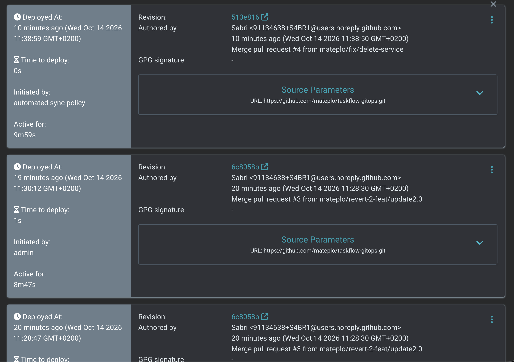
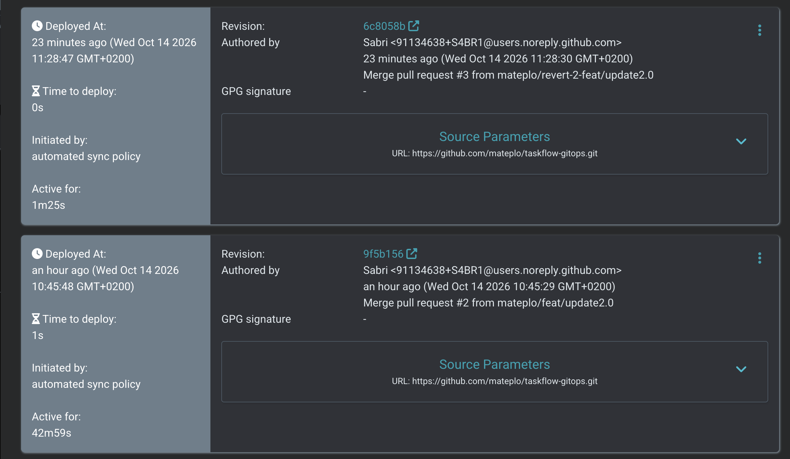
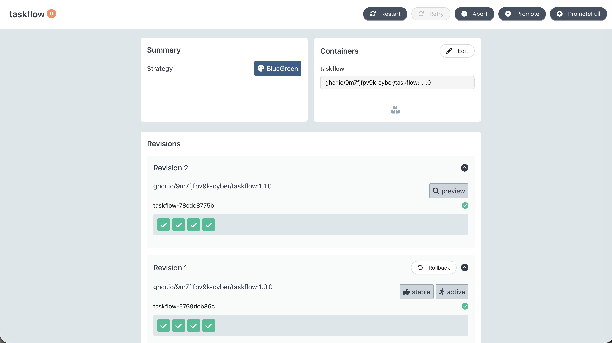
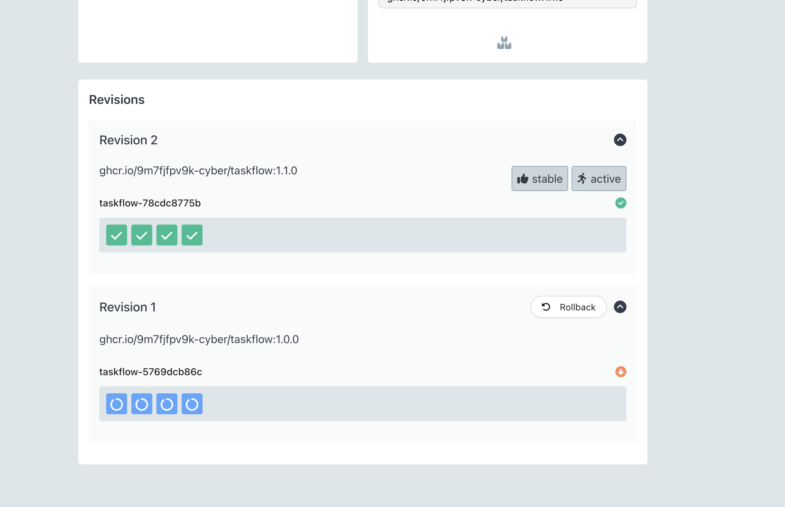

# taskflow-gitops — dépôt GitOps du cours CI/CD M2

Ce dépôt décrit **l'état voulu** de l'application TaskFlow dans Kubernetes.
Argo CD le surveille et aligne le cluster dessus : pour changer la production,
on ne tape pas de commande, on fait une **Pull Request**.

## Installation (à faire chez vous, avant le cours)

Prérequis : Docker Desktop démarré, 8 Go de RAM, 10 Go de disque libre.
Sous Windows : WSL2 (Ubuntu) + intégration WSL de Docker Desktop, et toutes les commandes dans WSL.

```bash
git clone https://github.com/9m7fjfpv9k-cyber/taskflow-gitops.git
cd taskflow-gitops
./scripts/install.sh
```

Le script crée un cluster local `kind`, installe Argo CD et Argo Rollouts,
puis télécharge les images des labs. Comptez 5 à 15 minutes.
Il peut être relancé sans risque.

## Structure

| Chemin | Rôle |
| --- | --- |
| `apps/taskflow/` | Les manifests surveillés par Argo CD |
| `argocd/application.yaml` | Déclare l'application dans Argo CD |
| `exemples/bluegreen/` | Manifests pour le déploiement Blue-Green |
| `exemples/canary/` | Manifests pour le déploiement Canary |
| `exemples/robustesse/` | Canary avec test de charge k6 automatique, modèle de postmortem |
| `exemples/ci/` | Pipelines de la mini-PSSI (GitHub Actions et GitLab CI) |
| `policies/` | Mini-PSSI et règles Rego vérifiées par conftest |
| `scripts/install.sh` | Installation de l'environnement |
| `scripts/argocd-ui.sh` | Ouvre l'interface d'Argo CD |
| `scripts/observe.sh` | Montre quelle version répond, et avec quel code HTTP |
| `scripts/charge.sh` | Lance à la main le test de charge k6 contre un service |

## Images disponibles

`ghcr.io/9m7fjfpv9k-cyber/taskflow` en versions `1.0.0`, `1.1.0`, `2.0.0`, `2.1.0` et `2.2.0`.

## Équipe

<!-- Noms du binôme -->
- Matteo MENCUCCINI
- Sabri ABID

## Livrable

### Argo CD : déploiements par Pull Request et `git revert`




Tous les déploiements viennent d'un pull, car c'est Argo CD qui va regarder la source de vérité (le repo GitHub) et ordonner le déploiement/la modification des ressources sur le cluster Kubernetes.

Le `git revert` sert à annuler les changements d'un commit existant, et donc à revenir en arrière. Cela permet à Argo CD d'annuler des changements faits (venant du repo ayant été modifié), car le nouveau commit de revert ramène le code à l'état d'avant (du point de vue du code, on est revenu en arrière ; du point de vue de l'historique, on a un commit en plus). Argo CD suit simplement la tête de la branche et aligne le cluster dessus.

### Argo Rollouts : Blue-Green

Comme on peut le voir, après avoir lancé la PR remplaçant le Deployment par un Rollout Blue-Green, et avoir lancé la deuxième PR pour changer la version de l'application, nous avons maintenant 4 pods dans l'ancienne version et 4 dans la nouvelle (chacune étant exposée via un service, comme précisé dans le YAML du Rollout : `taskflow` pour la version active, `taskflow-preview` pour la nouvelle).



Nous pouvons maintenant faire le promote du Rollout : le service actif `taskflow` bascule des pods blue (1.0.0) vers les pods green (1.1.0), qui deviennent la version de référence après le promote.

État avant promote :

```console
$ ./scripts/observe.sh
     40 version=1.0.0 http=200

$ kubectl get pods -n taskflow
NAME                        READY   STATUS    RESTARTS   AGE
taskflow-5769dcb86c-8nxzg   1/1     Running   0          46m
taskflow-5769dcb86c-dfzvd   1/1     Running   0          46m
taskflow-5769dcb86c-sj4nq   1/1     Running   0          46m
taskflow-5769dcb86c-wt95t   1/1     Running   0          46m
taskflow-78cdc8775b-97kbw   1/1     Running   0          11m
taskflow-78cdc8775b-dkbj6   1/1     Running   0          11m
taskflow-78cdc8775b-qbprt   1/1     Running   0          11m
taskflow-78cdc8775b-z6tv7   1/1     Running   0          11m
```

Résultat sur le service preview :

```console
$ ./scripts/observe.sh taskflow-preview
     40 version=1.1.0 http=200
```

Comme nous pouvons le voir, le rollout est instantané, car la nouvelle version a entièrement été poussée sur le cluster avant que l'ancienne version ne soit supprimée (principe du Blue-Green). La bascule se résume à un changement de selector sur le service, et les anciens pods sont supprimés 30 s plus tard (`scaleDownDelaySeconds: 30`).



État après promote :

```console
$ ./scripts/observe.sh
     40 version=1.1.0 http=200
```
