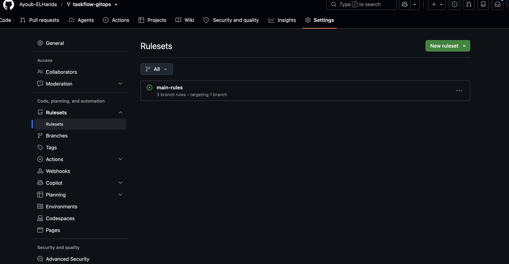
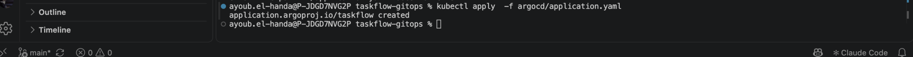
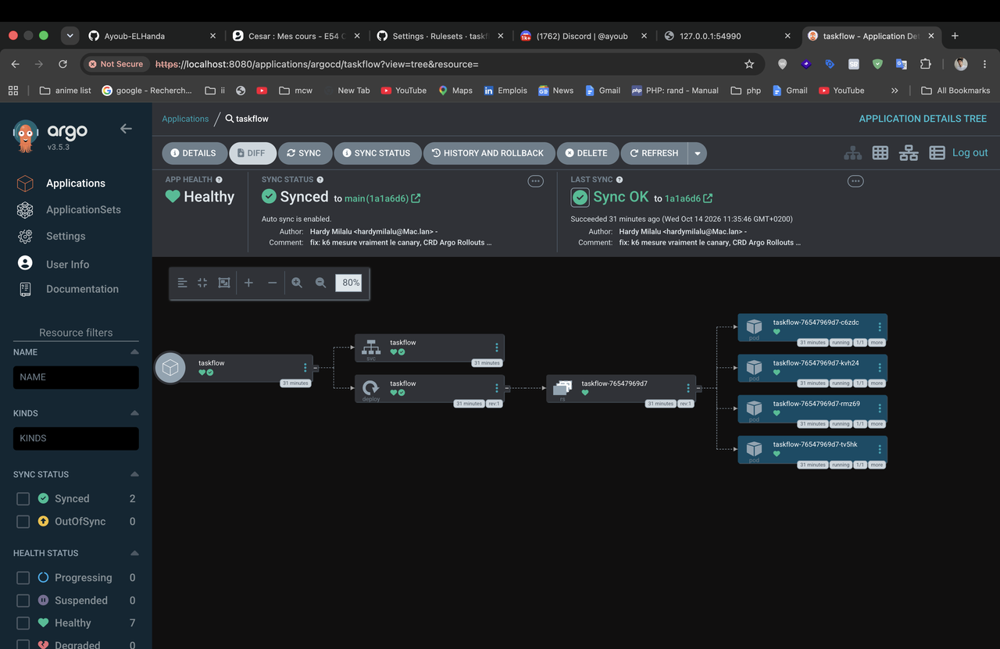
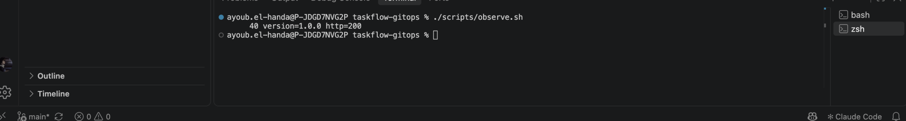

# taskflow-gitops — dépôt GitOps du cours CI/CD M2

Ce dépôt décrit **l'état voulu** de l'application TaskFlow dans Kubernetes.
Argo CD le surveille et aligne le cluster dessus : pour changer la production,
on ne tape pas de commande, on fait une **Pull Request**.

## Installation (à faire chez vous, avant le cours)

Prérequis : Docker Desktop démarré, 8 Go de RAM, 10 Go de disque libre.
Sous Windows : WSL2 (Ubuntu) + intégration WSL de Docker Desktop, et toutes les commandes dans WSL.

```bash
git clone https://github.com/9m7fjfpv9k-cyber/taskflow-gitops.git
cd taskflow-gitops
./scripts/install.sh
```

Le script crée un cluster local `kind`, installe Argo CD et Argo Rollouts,
puis télécharge les images des labs. Comptez 5 à 15 minutes.
Il peut être relancé sans risque.

## Structure

| Chemin | Rôle |
| --- | --- |
| `apps/taskflow/` | Les manifests surveillés par Argo CD |
| `argocd/application.yaml` | Déclare l'application dans Argo CD |
| `exemples/bluegreen/` | Manifests pour le déploiement Blue-Green |
| `exemples/canary/` | Manifests pour le déploiement Canary |
| `exemples/robustesse/` | Canary avec test de charge k6 automatique, modèle de postmortem |
| `exemples/ci/` | Pipelines de la mini-PSSI (GitHub Actions et GitLab CI) |
| `policies/` | Mini-PSSI et règles Rego vérifiées par conftest |
| `scripts/install.sh` | Installation de l'environnement |
| `scripts/argocd-ui.sh` | Ouvre l'interface d'Argo CD |
| `scripts/observe.sh` | Montre quelle version répond, et avec quel code HTTP |
| `scripts/charge.sh` | Lance à la main le test de charge k6 contre un service |

## Images disponibles

`ghcr.io/9m7fjfpv9k-cyber/taskflow` en versions `1.0.0`, `1.1.0`, `2.0.0`, `2.1.0` et `2.2.0`.

## Compte rendu du lab — déployer par PR, provoquer une dérive, revenir en arrière

Le lab illustre un flux GitOps : Git contient l'état souhaité, et Argo CD le
réconcilie avec Kubernetes. Les captures ci-dessous sont les éléments de preuve
disponibles dans le dépôt. Elles montrent la configuration de branche, l'état
de l'application et l'observation de la version initiale ; elles ne documentent
pas à elles seules les PR de mise à jour, de revert ou de suppression.

### 1. Fork, binôme et règles de branche

Forkez le dépôt, invitez votre binôme parmi les collaborateurs, puis configurez
un ruleset ciblant `main` dans **Settings > Rules > Rulesets**. Le ruleset doit
protéger les changements apportés à cette branche, notamment en demandant une
Pull Request plutôt qu'un push direct.

La capture confirme qu'un ruleset `main-rules` cible une branche. Elle ne montre
pas les options sélectionnées ni l'invitation du binôme.



### 2. Déclarer le dépôt dans Argo CD

Vérifiez que `repoURL` dans [`argocd/application.yaml`](argocd/application.yaml)
pointe vers le fork utilisé par votre binôme. Dans ce dépôt, l'URL est déjà
`https://github.com/Ayoub-ELHanda/taskflow-gitops.git`. Sur chaque cluster,
vérifiez le contexte puis créez ou mettez à jour l'Application :

```bash
kubectl config current-context
# Le contexte attendu est kind-cicd.
kubectl apply -f argocd/application.yaml
```

L'Application suit `main` et le répertoire `apps/taskflow`. La synchronisation
automatique y est activée.

### 3. Vérifier l'état initial et la version servie

Dans Argo CD, l'application `taskflow` doit afficher **Healthy** et **Synced**.
Lancez ensuite le script d'observation :

```bash
./scripts/observe.sh
```

Il envoie 40 requêtes au Service et regroupe les réponses par version et code
HTTP. La capture fournie montre 40 réponses `version=1.0.0 http=200`, ce qui
confirme l'état initial observé.







### 4. Déployer la version 2.0.0 par Pull Request

Dans une branche de travail, modifiez l'image du Deployment dans
[`apps/taskflow/deployment.yaml`](apps/taskflow/deployment.yaml), de `1.0.0` à
`2.0.0`. Poussez cette branche, ouvrez une PR vers `main`, faites-la relire,
puis fusionnez-la. Argo CD détecte la nouvelle révision et applique le manifeste.
Vérifiez que l'application redevient **Healthy** et **Synced**, puis lancez
`./scripts/observe.sh` pour confirmer que les réponses indiquent `2.0.0`.

Pour mesurer le délai, notez l'heure de fusion de la PR et l'heure à laquelle
Argo CD indique **Synced** et l'observation renvoie la nouvelle version. Le
délai correspond à la différence entre ces deux instants. Aucune capture fournie
ne montre cette PR ni ses horodatages : le délai réel reste donc à renseigner
dans le journal de déploiement.

### 5. Provoquer une dérive et observer l'auto-réconciliation

Après le déploiement de la PR, modifiez temporairement le cluster directement :

```bash
kubectl scale deployment/taskflow --replicas=1 -n taskflow
kubectl set image deployment/taskflow \
  taskflow=ghcr.io/9m7fjfpv9k-cyber/taskflow:1.0.0 -n taskflow
```

Ces commandes créent une dérive par rapport à Git : le nombre de réplicas et
l'image ne correspondent plus à `apps/taskflow/deployment.yaml`. Comme
`selfHeal: true` est configuré dans l'Application, Argo CD détecte l'écart et
réapplique l'état déclaré dans Git (image `2.0.0` et quatre réplicas). La
correction est automatique ; les commandes `kubectl` ne modifient pas la source
de vérité. Vérifiez le retour à **Synced**, puis les pods et les réponses du
Service.

### 6. Revenir à la version 1.0.0 avec Revert

Utilisez **Revert** sur la PR fusionnée de mise à jour dans GitHub. GitHub crée
une nouvelle PR qui annule le changement ; après revue et fusion, le manifeste
dans `main` déclare à nouveau l'image `1.0.0`. Argo CD applique cette révision,
puis `./scripts/observe.sh` permet de vérifier le retour de la version servie à
`1.0.0`.

Un revert Git conserve l'historique : il ajoute un changement inverse au lieu
de réécrire ou supprimer la PR précédente. Cela rend le retour en arrière
traçable et laisse Argo CD réconcilier le cluster à partir de Git.

### 7. Bonus — supprimer le Service par PR

Supprimez `apps/taskflow/service.yaml` dans une branche, puis ouvrez et fusionnez
une PR vers `main`. Avec `prune: true`, Argo CD supprime du cluster la ressource
Service qui n'est plus déclarée dans le dépôt. Les pods du Deployment peuvent
rester en fonctionnement, mais le Service `taskflow` n'existe plus et les
requêtes via ce point d'accès échouent. Vérifiez la suppression dans l'arbre
des ressources Argo CD ou avec :

```bash
kubectl -n taskflow get service taskflow
```

La commande doit alors signaler que le Service est introuvable. Cette étape est
destructive pour l'accès à l'application : ne la faites que dans le cluster de
lab.

### Journal et réponses à remettre

Complétez les informations qui ne figurent pas dans les captures avant de
remettre le compte rendu :

| Étape | Révision ou action | Résultat à consigner |
| --- | --- | --- |
| État initial | Image `1.0.0` | 40 réponses HTTP 200 observées |
| Mise à jour | PR vers l'image `2.0.0` | Lien/numéro de PR, heure de fusion, heure de disponibilité, délai mesuré |
| Dérive | `scale` puis `set image` | Temps de retour à l'état Git et version observée |
| Retour arrière | PR Revert | Lien/numéro de PR et confirmation de `1.0.0` |
| Bonus | Suppression de `service.yaml` | Lien/numéro de PR et confirmation du prune |

**Push ou pull ?** Le changement de configuration est poussé dans Git par le
développeur, au moyen d'une branche et d'une PR. Pour le déploiement, Argo CD
utilise un modèle *pull* : il surveille le dépôt, récupère l'état désiré et le
réconcilie avec le cluster. Un push direct sur Kubernetes n'est pas le mécanisme
de déploiement attendu.

**Qui a corrigé quoi ?** À consigner avec les vrais noms et liens des PR : la
personne qui a proposé la modification change le manifeste ; le binôme la relit
et l'approuve selon les règles de `main` ; après fusion, Argo CD applique la
révision. Pour une dérive manuelle, Argo CD restaure lui-même la configuration
Git grâce à `selfHeal`. Les captures disponibles ne permettent pas d'attribuer
ces actions à des personnes précises.

**Pourquoi utiliser Git Revert ?** Le revert fournit une correction revue et
auditée dans l'historique Git. Il restaure la configuration voulue sans masquer
la modification initiale ; Argo CD voit le nouvel état de `main` et ramène le
cluster à cet état.

## Équipe

<!-- Noms du binôme -->
- À compléter
