# taskflow-gitops — dépôt GitOps du cours CI/CD M2

Ce dépôt décrit **l'état voulu** de l'application TaskFlow dans Kubernetes.
Argo CD le surveille et aligne le cluster dessus : pour changer la production,
on ne tape pas de commande, on fait une **Pull Request**.

## Installation (à faire chez vous, avant le cours)

Prérequis : Docker Desktop démarré, 8 Go de RAM, 10 Go de disque libre.
Sous Windows : WSL2 (Ubuntu) + intégration WSL de Docker Desktop, et toutes les commandes dans WSL.

```bash
git clone https://github.com/9m7fjfpv9k-cyber/taskflow-gitops.git
cd taskflow-gitops
./scripts/install.sh
```

Le script crée un cluster local `kind`, installe Argo CD et Argo Rollouts,
puis télécharge les images des labs. Comptez 5 à 15 minutes.
Il peut être relancé sans risque.

> **Note sur notre environnement.** Sur le poste de Denilsson, le trafic HTTPS sortant de WSL2 est bloqué par la politique de sécurité du poste (DNS et ICMP fonctionnent, TCP 443 expire, y compris en mode réseau mirrored). L'installation a donc été faite directement sous Windows avec un équivalent PowerShell de `install.sh`, en passant par Docker Desktop : même cluster `kind-cicd`, Argo CD v3.5.3 et Argo Rollouts v1.10.0.

## Structure

| Chemin | Rôle |
| --- | --- |
| `apps/taskflow/` | Les manifests surveillés par Argo CD |
| `argocd/application.yaml` | Déclare l'application dans Argo CD |
| `exemples/bluegreen/` | Manifests pour le déploiement Blue-Green |
| `exemples/canary/` | Manifests pour le déploiement Canary |
| `exemples/robustesse/` | Canary avec test de charge k6 automatique, modèle de postmortem |
| `exemples/ci/` | Pipelines de la mini-PSSI (GitHub Actions et GitLab CI) |
| `policies/` | Mini-PSSI et règles Rego vérifiées par conftest |
| `scripts/install.sh` | Installation de l'environnement |
| `scripts/argocd-ui.sh` | Ouvre l'interface d'Argo CD |
| `scripts/observe.sh` | Montre quelle version répond, et avec quel code HTTP |
| `scripts/charge.sh` | Lance à la main le test de charge k6 contre un service |

## Images disponibles

`ghcr.io/9m7fjfpv9k-cyber/taskflow` en versions `1.0.0`, `1.1.0`, `2.0.0`, `2.1.0` et `2.2.0`.

## Équipe

<!-- Noms du binôme -->
- Denilsson ([@DENFR18](https://github.com/DENFR18)) : propriétaire du fork
- Illies ([@IB432](https://github.com/IB432)) : collaborateur (write)

---

## Lab du matin : déployer par PR, provoquer une dérive, revenir en arrière

### Configuration

L'application Argo CD (`argocd/application.yaml`) pointe sur notre fork :

| Paramètre | Valeur | Effet |
|---|---|---|
| `repoURL` | `https://github.com/DENFR18/taskflow-gitops.git` | Argo CD suit notre fork |
| `targetRevision` | `main` | Seule la branche protégée est déployée |
| `path` | `apps/taskflow` | Dossier des manifests (Deployment de 4 replicas + Service) |
| `automated` | activé | Synchronisation automatique, sans clic |
| `selfHeal` | `true` | Toute modification manuelle du cluster est annulée |
| `prune` | `true` | Une ressource supprimée de Git est supprimée du cluster |
| `timeout.reconciliation` | `60s` | Argo CD relit Git toutes les 60 s (réglé par `install.sh`) |

La branche `main` est protégée par un ruleset : PR obligatoire, 1 approbation, force push et suppression interdits. Chaque changement de cet exercice est passé par une PR approuvée par le binôme.

### Étapes

1. **Mise en service.** Après la modification du `repoURL` (PR #2, commit `abcc67a`), `kubectl apply -f argocd/application.yaml` : l'application passe en **Synced / Healthy** avec 4 pods en 1.0.0.

   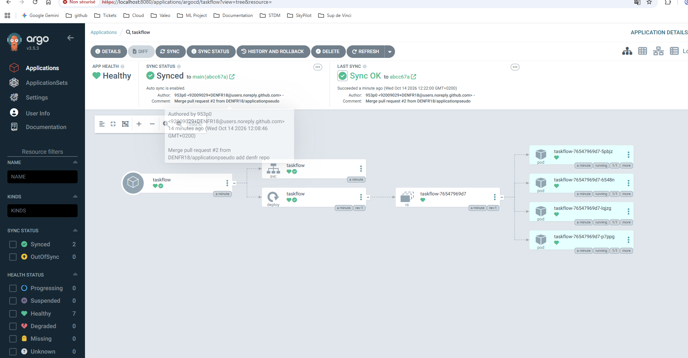

2. **Déploiement de la 2.0.0 par PR (#3).** L'image est définie dans `apps/taskflow/deployment.yaml`. Son tag passe de `1.0.0` à `2.0.0`.

   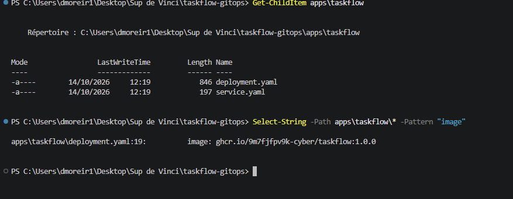

   Après le merge, Argo CD détecte le nouveau commit et Kubernetes effectue un rolling update : les pods 2.0.0 démarrent avant l'arrêt des pods 1.0.0, sans coupure de service.

   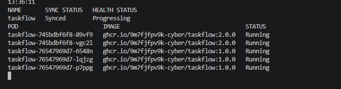

3. **Dérive 1 : `kubectl scale --replicas=1`.** Argo CD détecte l'écart dans la seconde et réapplique les 4 replicas définis dans Git. Les pods `Succeeded` sont ceux arrêtés par le `scale`, les pods `Pending` ceux recréés par Argo CD.

   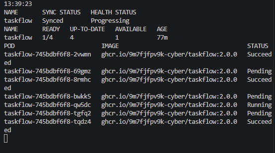

4. **Dérive 2 : `kubectl set image ...:1.1.0`.** L'application passe en **OutOfSync**, puis Argo CD réapplique l'image 2.0.0.

   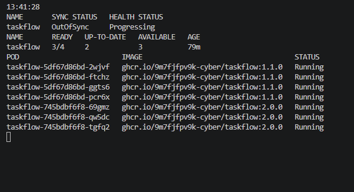

   Chaque dérive suit le même cycle dans les événements de l'application : `Synced -> OutOfSync`, `Initiated automated sync`, `Partial sync operation succeeded` (seul le Deployment modifié est réappliqué), puis `Progressing -> Healthy`.

   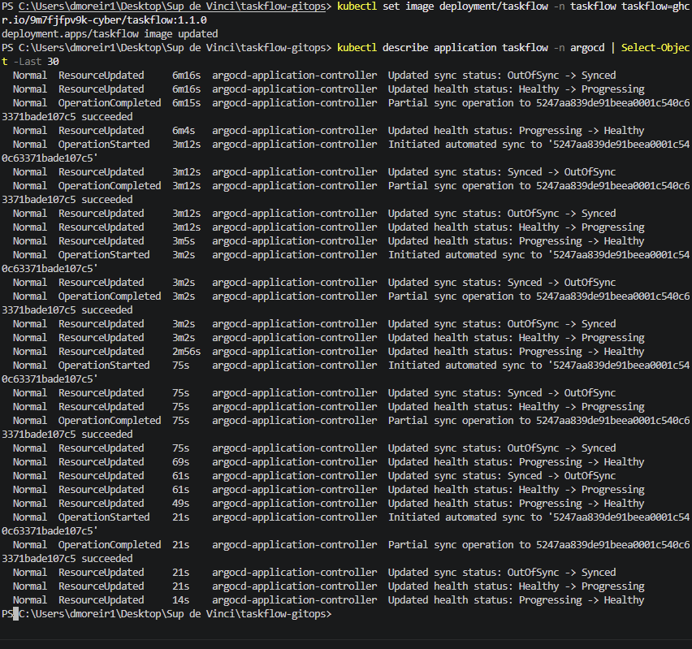

5. **Retour en 1.0.0 avec le bouton Revert de GitHub (PR #4).** Le revert passe par le même circuit qu'un déploiement : la PR est bloquée tant que le binôme ne l'a pas approuvée.

   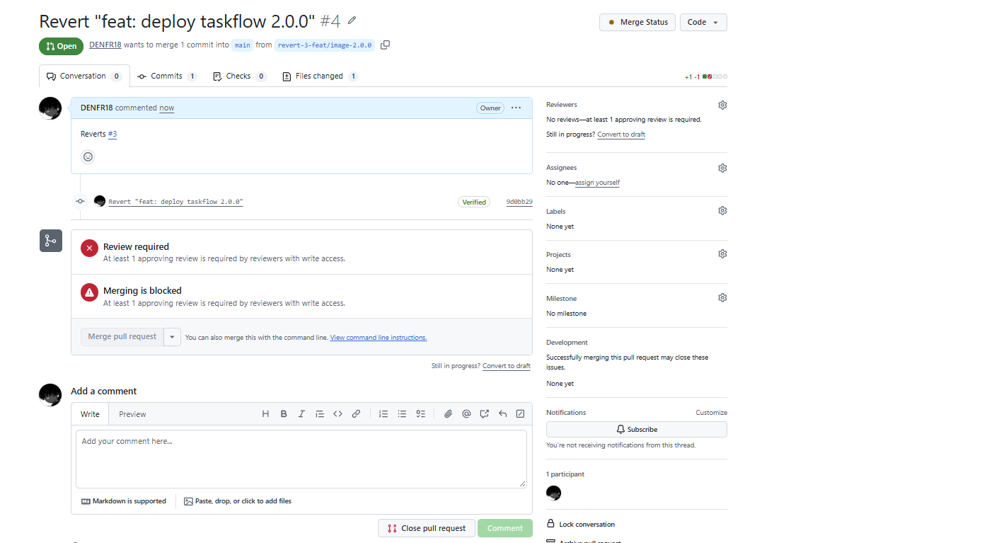

   Après le merge (commit `19ce3cb`), les pods reviennent en 1.0.0 avec le même ReplicaSet qu'au départ (`taskflow-76547969d7`) : le modèle de pod est identique à l'original.

   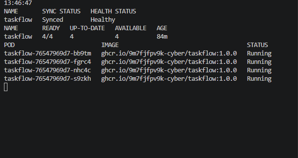

Les événements de l'application Argo CD retracent toute la séquence (heures en UTC, soit Paris − 2 h) :

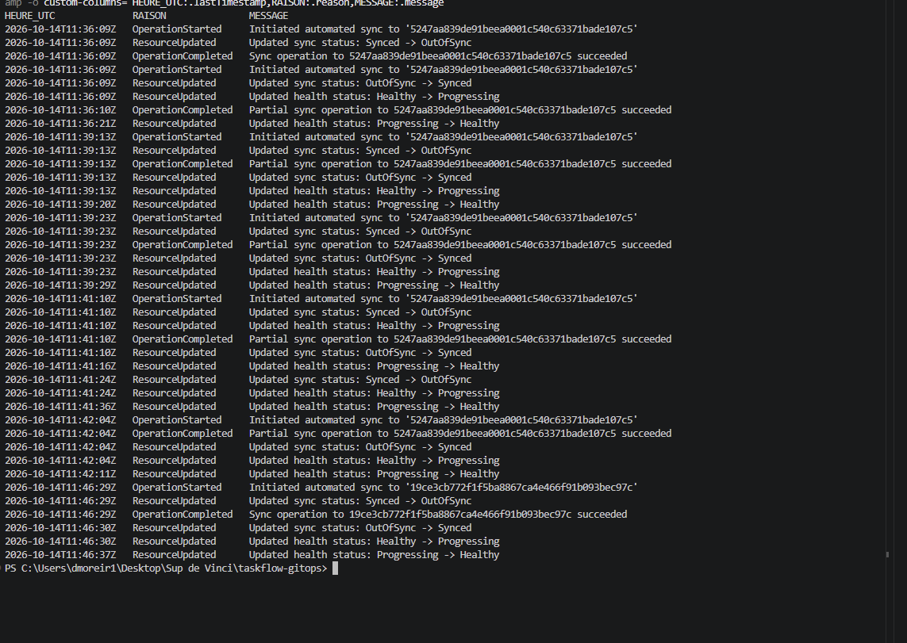

### Journal des déploiements

Heures de Paris. Les heures de merge proviennent des commits de merge (`git log`), celles de synchronisation des événements Argo CD.

| Heure | Action | Commit / PR | Version attendue (Git) | État Argo CD | Délai observé |
|---|---|---|---|---|---|
| 12:22:00 | `kubectl apply` de l'Application | PR #2 (`abcc67a`) | 1.0.0 | Synced / Healthy | — |
| 13:35:17 | Merge PR image 2.0.0 | PR #3 (`5247aa8`) | 2.0.0 | Sync auto à 13:36:09, Healthy à 13:36:21 | Détection en 52 s, déploiement complet en 1 min 04 s |
| 13:39:13 | `kubectl scale --replicas=1` (dérive) | — | 4 replicas | OutOfSync → sync auto immédiate → Healthy à 13:39:20 | Correction en 0 s, retour à 4 pods en 7 s |
| 13:41:10 | `kubectl set image ...:1.1.0` (dérive) | — | 2.0.0 | Corrigé à 13:41:10 ; nouvel OutOfSync à 13:41:24, re-sync à 13:42:04, Healthy à 13:42:11 | 0 s, puis 40 s sur le second cycle |
| 13:45:54 | Merge PR Revert (bouton GitHub) | PR #4 (`19ce3cb`) | 1.0.0 | Sync auto à 13:46:29, Healthy à 13:46:37 | Détection en 35 s, retour complet en 43 s |

Heures de merge relevées avec `git log` :

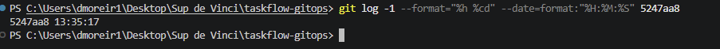

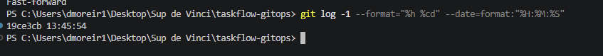

### Réponses

**Push ou pull ?**

Pull. Aucun outil ne pousse les changements vers le cluster : c'est Argo CD, installé dans le cluster, qui relit régulièrement le dépôt Git et applique ce qui a changé. Les mesures le montrent : après un merge, le déploiement n'est pas immédiat, il arrive au prochain cycle de lecture (52 s pour la 2.0.0, 35 s pour le revert, toujours sous les 60 s de `timeout.reconciliation`). Conséquence côté sécurité : GitHub n'a besoin d'aucun accès au cluster, c'est le cluster qui vient chercher l'état voulu.

**Qui a corrigé quoi ?**

Les modifications manuelles faites avec `kubectl` ont été corrigées par **Argo CD**, grâce à `selfHeal` : le passage à 1 replica et le changement d'image vers 1.1.0 ont été annulés dans la seconde, par une synchronisation partielle qui réapplique uniquement le Deployment modifié. Sur la dérive d'image, une seconde détection n'a été corrigée qu'après 40 s ; nous l'interprétons comme un délai croissant appliqué par Argo CD entre deux self-heals successifs, sans l'avoir vérifié dans la documentation. Le retour de la 2.0.0 vers la 1.0.0, lui, a été décidé et fait par **nous**, via une PR de revert relue et approuvée : Argo CD n'a fait qu'appliquer ce que Git contenait.

**Pourquoi git revert ?**

`git revert` ajoute un nouveau commit qui annule le précédent, sans réécrire l'historique. Le retour arrière passe donc par le même circuit qu'un déploiement : PR, approbation du binôme, ruleset (le force push étant interdit sur `main`, un `git reset` ne serait de toute façon pas possible). L'historique garde la trace de qui a annulé quoi et quand, et Git reste la seule source de vérité. À l'inverse, un `kubectl rollout undo` serait une dérive comme les autres, qu'Argo CD annulerait immédiatement grâce au self-heal.