# taskflow-gitops — dépôt GitOps du cours CI/CD M2

Ce dépôt décrit **l'état voulu** de l'application TaskFlow dans Kubernetes.
Argo CD le surveille et aligne le cluster dessus : pour changer la production,
on ne tape pas de commande, on fait une **Pull Request**.

## Installation (à faire chez vous, avant le cours)

Prérequis : Docker Desktop démarré, 8 Go de RAM, 10 Go de disque libre.
Sous Windows : WSL2 (Ubuntu) + intégration WSL de Docker Desktop, et toutes les commandes dans WSL.

```bash
git clone https://github.com/9m7fjfpv9k-cyber/taskflow-gitops.git
cd taskflow-gitops
./scripts/install.sh
```

Le script crée un cluster local `kind`, installe Argo CD et Argo Rollouts,
puis télécharge les images des labs. Comptez 5 à 15 minutes.
Il peut être relancé sans risque.

## Structure

| Chemin | Rôle |
| --- | --- |
| `apps/taskflow/` | Les manifests surveillés par Argo CD |
| `argocd/application.yaml` | Déclare l'application dans Argo CD |
| `exemples/bluegreen/` | Manifests pour le déploiement Blue-Green |
| `exemples/canary/` | Manifests pour le déploiement Canary |
| `exemples/robustesse/` | Canary avec test de charge k6 automatique, modèle de postmortem |
| `exemples/ci/` | Pipelines de la mini-PSSI (GitHub Actions et GitLab CI) |
| `policies/` | Mini-PSSI et règles Rego vérifiées par conftest |
| `scripts/install.sh` | Installation de l'environnement |
| `scripts/argocd-ui.sh` | Ouvre l'interface d'Argo CD |
| `scripts/observe.sh` | Montre quelle version répond, et avec quel code HTTP |
| `scripts/charge.sh` | Lance à la main le test de charge k6 contre un service |

## Images disponibles

`ghcr.io/9m7fjfpv9k-cyber/taskflow` en versions `1.0.0`, `1.1.0`, `2.0.0`, `2.1.0` et `2.2.0`.

## Équipe

- Hmz92 (compte GitHub `Hmz92`)
- Ezzat Saoud (compte GitHub `ezzatsd`), relecteur des PR

## Journal des déploiements (J2, 14/10/2026)

Nous avons fait ce lab en binôme : Hamza proposait les changements, Ezzat relisait et approuvait chaque PR. Les heures ci-dessous sont en UTC (en France, ajoutez 2 h). Nous les avons relevées après coup dans l'historique GitHub et dans celui d'Argo CD, pour ne pas dépendre de notre mémoire.

### Comment ça s'est passé

On a commencé par installer le cluster kind avec Argo CD et Argo Rollouts, puis posé un ruleset sur `main` : plus de push direct, une PR et une approbation obligatoires. On a ensuite remplacé `VOTRE-PSEUDO` par `Hmz92` dans `argocd/application.yaml` (PR #1) et lancé le seul `kubectl apply` du lab pour déclarer l'application. Premier essai raté : nous l'avions fait avant le merge de la PR, Argo CD était donc resté sur `Unknown` en cherchant un dépôt qui n'existait pas. Après le merge et un second `apply`, tout est passé en `Synced` et `Healthy`, avec 4 pods en 1.0.0.

Ensuite, la PR #2 a passé l'image en 2.0.0. Ezzat l'a approuvée vers 09:06, nous l'avons mergée juste après, et Argo CD a déployé vers 09:09, soit **environ 2 minutes** plus tard. Ce n'est pas la minute annoncée dans le cours : Argo CD interroge Git à intervalle régulier, il n'est pas prévenu par un webhook. `observe.sh` a confirmé 40 réponses sur 40 en `version=2.0.0`.

Puis on a joué les apprentis saboteurs : `kubectl scale` pour descendre à 1 réplica, et `kubectl set image` pour remettre la 1.0.0 à la main. Dans les deux cas, Argo CD a tout remis comme Git le dit (4 pods, 2.0.0), sans que nous fassions quoi que ce soit. Nous n'avons pas noté l'heure de ces deux manipulations : nous savons donc que la correction est rapide, mais pas de combien de secondes.

Enfin, le retour arrière : le bouton Revert de GitHub sur la PR #2 a créé la PR #5, approuvée puis mergée vers 09:22. La production est repassée en 1.0.0 vers 09:24 (environ 2 minutes) et `observe.sh` a de nouveau répondu 40 fois en 1.0.0. Les pods d'origine sont revenus avec le même identifiant de ReplicaSet que le premier jour : Kubernetes avait gardé l'ancien et l'a simplement réactivé.

Pour le bonus, on a voulu voir `prune` en action : une PR (#10) a supprimé `apps/taskflow/service.yaml`, approuvée par Ezzat et mergée vers 10:19. Quelques minutes plus tard, le service avait bel et bien disparu du cluster (`No resources found`), alors que l'application restait `Synced` et `Healthy`. Pourtant, `observe.sh` ne recevait plus aucune réponse (`version=aucune http=000`) : les pods tournaient, mais plus rien ne permettait de les joindre. On a remis le service par un revert (PR #11, mergée vers 10:28). Il est revenu de lui-même en moins de deux minutes avec une nouvelle adresse interne (`10.96.231.164` au lieu de `10.96.21.92`), et `observe.sh` a de nouveau répondu 40 fois en 1.0.0.

### Le tableau

| Merge (UTC) | Ce qu'on a changé | Déployé (UTC) | Délai | Ce qu'on a constaté |
| --- | --- | --- | --- | --- |
| ~08:57 | PR #1 : `repoURL` du fork (+ `kubectl apply`) | ~08:57 | < 1 min | `Synced` + `Healthy`, 4 pods en 1.0.0 |
| ~09:07 | PR #2 : image 1.0.0 → 2.0.0 | ~09:09 | ~2 min | 40/40 en `version=2.0.0 http=200` |
| pas de merge | Dérives à la main : `scale` à 1, puis `set image` 1.0.0 | corrigé par Argo CD | non mesuré | retour automatique à 4 pods en 2.0.0 |
| ~09:22 | PR #5 : revert de la PR #2 | ~09:24 | ~2 min | 40/40 en `version=1.0.0 http=200` |
| ~09:24 | PR #6 : revert de la PR #1, **par erreur** | pas de déploiement | n/a | `application.yaml` de `main` est revenu à `VOTRE-PSEUDO` |
| ~09:43 | PR #8 : revert de la PR #6, pour réparer | pas de déploiement (seul `application.yaml` change) | n/a | `repoURL` de `main` de nouveau à `Hmz92`, Git et cluster d'accord |
| ~10:19 | PR #10 : suppression de `service.yaml` (test de `prune`) | quelques minutes après | n/a | service supprimé du cluster, application `Synced` + `Healthy`, mais `observe.sh` : `http=000` |
| ~10:28 | PR #11 : revert de la PR #10 | < 2 min | < 2 min | service recréé, 40/40 en `version=1.0.0 http=200` |

Quelques précisions : les PR #3 (premier essai de revert de la #2) et #7 (premier essai de revert de la #6) ont été fermées sans merge, remplacées par la #5 et la #8. La PR #9 est celle qui a publié ce journal et les captures.

### Preuves

- Cluster kind, Argo CD et Argo Rollouts installés : 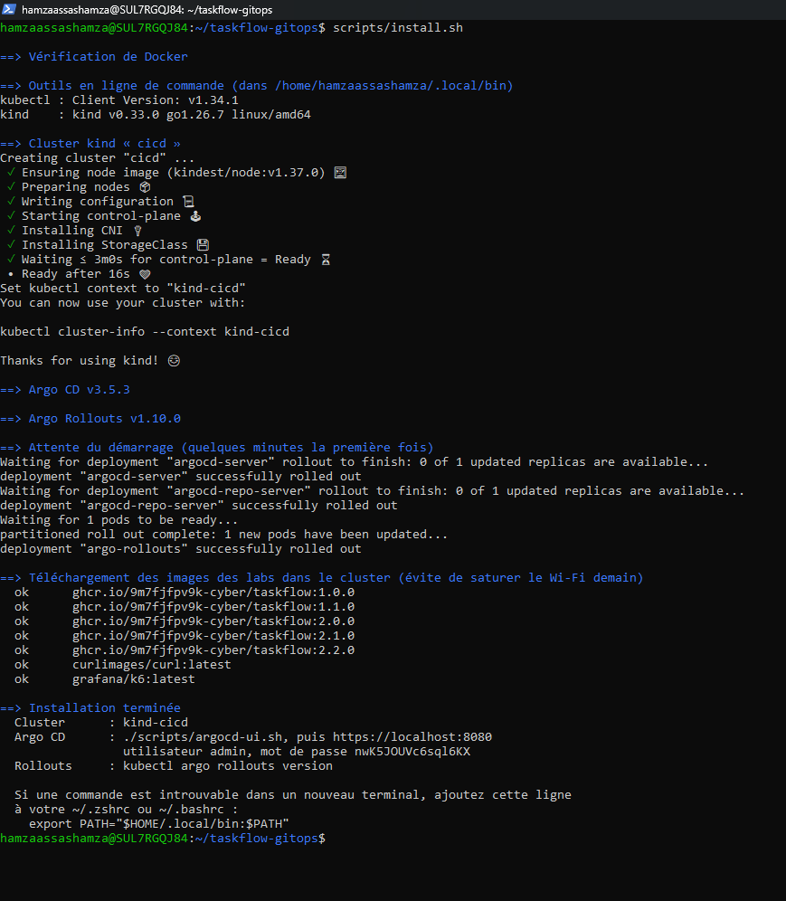
- Ruleset sur `main` (PR obligatoire, 1 approbation, pas de force push) : 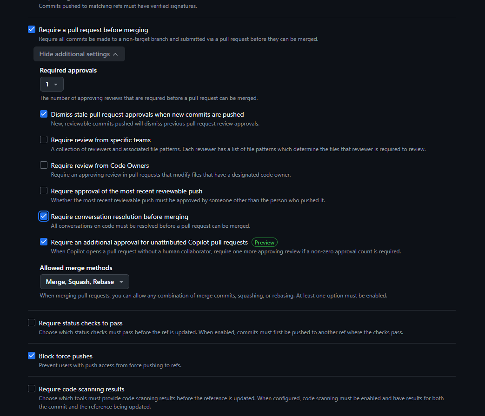
- PR #1, le `repoURL` : 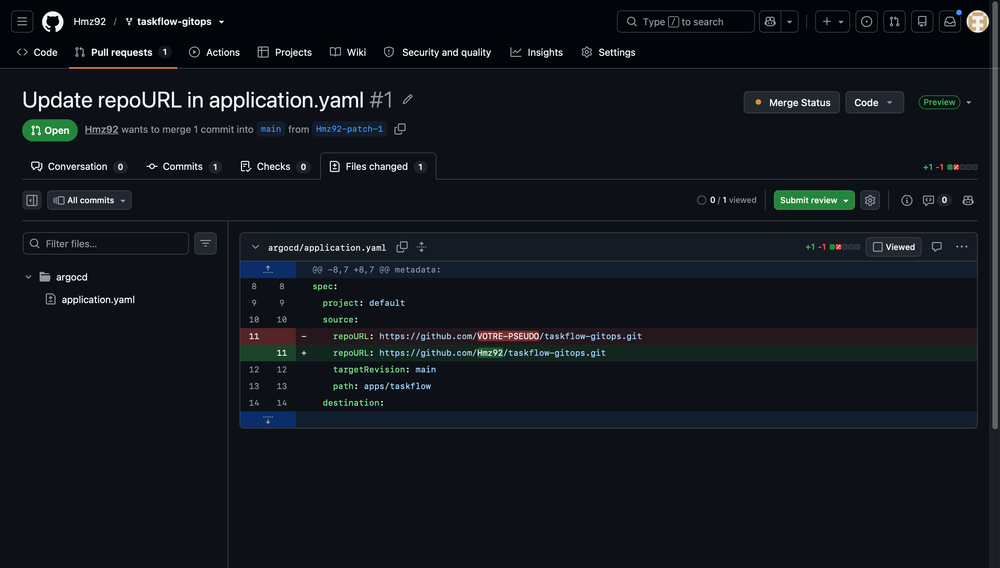
- `Synced` + `Healthy`, 4 pods, `observe.sh` en 1.0.0 : 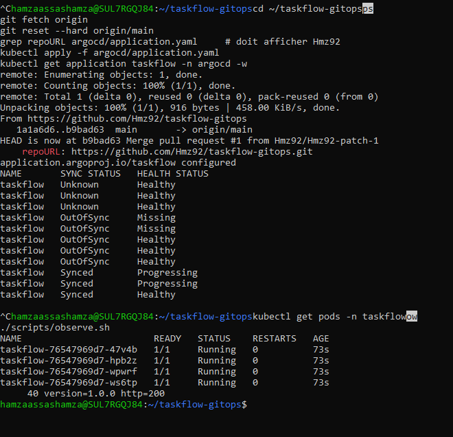
- PR #2, l'image 2.0.0 : 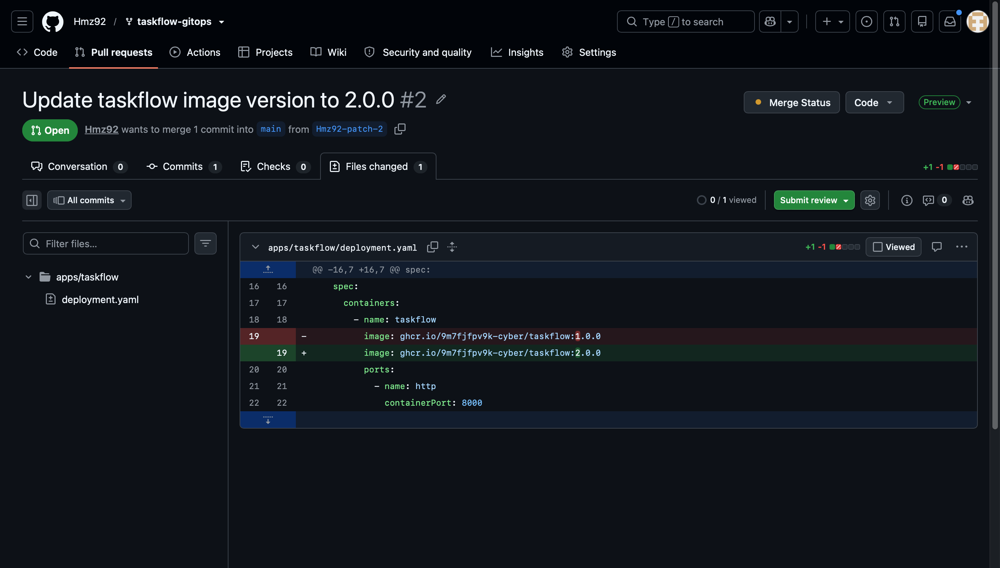
- Nouveaux pods et `observe.sh` en 2.0.0 : 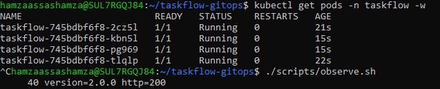
- Après la dérive, l'image est revenue à 2.0.0 : 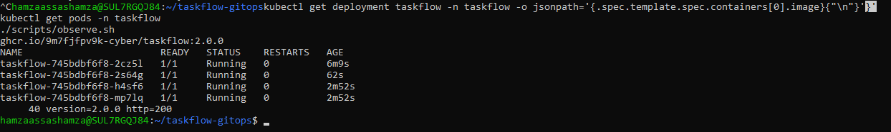
- Après le revert, `observe.sh` en 1.0.0 : 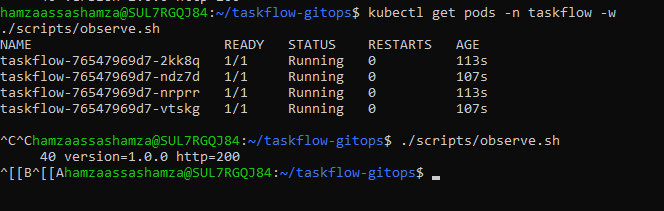
- Bonus `prune` : le service a disparu du cluster : 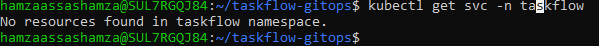
- Bonus `prune` : `Synced` + `Healthy`, mais plus aucune réponse : 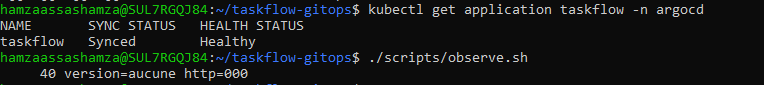
- Bonus `prune` : service revenu après le revert, `observe.sh` en 1.0.0 : 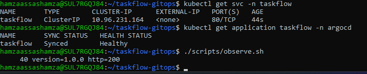

### Nos réponses aux 3 questions

**Push ou pull ?** C'est du pull. Argo CD vit dans le cluster, il va lire Git et applique l'écart. Notre pipeline n'a jamais eu besoin d'un accès au cluster. La seule commande `kubectl apply` du lab sert à déclarer l'application une fois, le reste est passé par des PR.

**Qui a corrigé quoi ?** Nous avons causé les deux dérives (le `scale` et le `set image`). C'est Argo CD qui les a détectées et défaites tout seul grâce à `selfHeal: true`. Il se fie à Git, pas à ce qui tourne dans le cluster : peu importe ce qu'on tape à la main, c'est l'état déclaré dans Git qui gagne.

**Pourquoi `git revert` ?** Parce que ça laisse une trace : un commit, une PR, un relecteur, une heure. Et on peut l'annuler à son tour, ce qui nous a d'ailleurs servi (voir ci-dessous). Un `kubectl rollout undo` ou un `set image` direct serait défait par Argo CD au prochain passage, puisque Git dirait toujours 2.0.0, et il n'y aurait aucune trace de qui a fait quoi.

### Ce que le bonus nous a appris sur `prune`

`prune: true` fait ce qu'il dit : ce qui disparaît de Git disparaît du cluster, même quand c'est un élément aussi important que le service. Argo CD n'a pas jugé que c'était dangereux, il a juste appliqué Git. L'application est restée `Healthy` alors que plus personne ne pouvait l'atteindre : l'état vu par Argo CD ne dit pas ce que vivent les utilisateurs, et il faut une vérification de l'extérieur (ici `observe.sh`) pour s'en apercevoir. Garde-fou utile : tout passe par une PR relue, donc la suppression d'un fichier aussi sensible se voit et se discute avant d'être appliquée.

### Ce qu'on retient (y compris notre erreur)

Le revert de la PR #6 avait visé la mauvaise PR : au lieu d'annuler le changement d'image, il avait annulé la correction du `repoURL`. Le cluster ne s'en est pas ressenti, car l'application avait déjà été déclarée avec le bon dépôt, mais `main` et le cluster ne disaient plus la même chose. Sans l'historique des PR et des commits, cet écart serait passé inaperçu. Nous l'avons corrigé comme le reste, par un revert du revert (PR #8), relu et approuvé par Ezzat vers 09:43.
